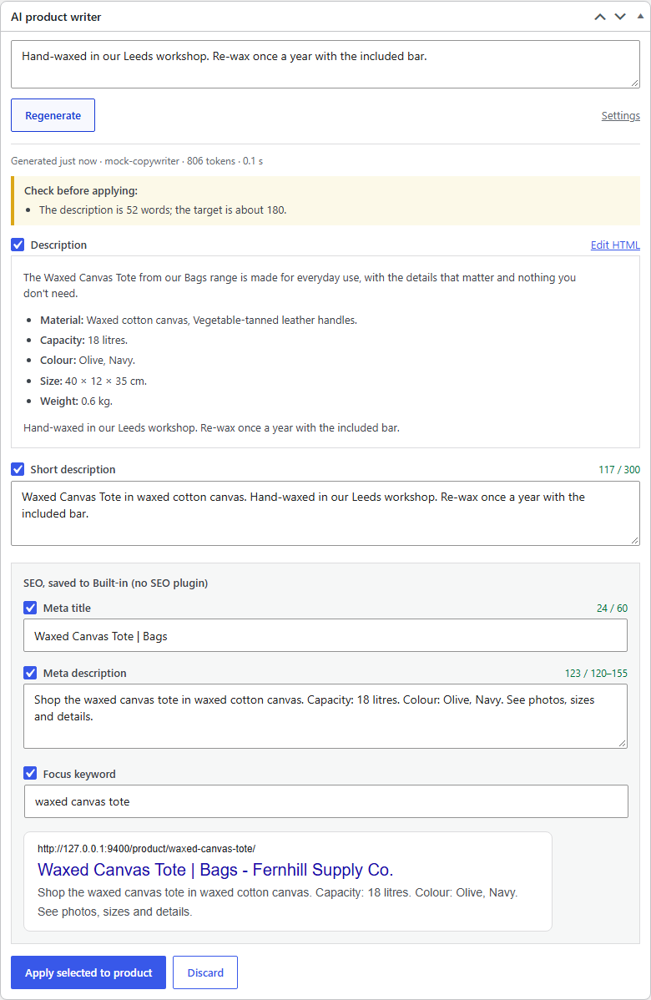
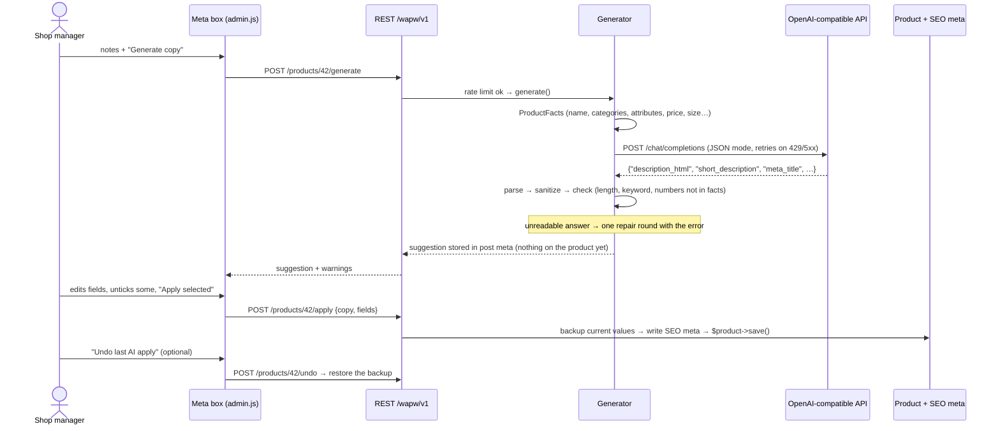
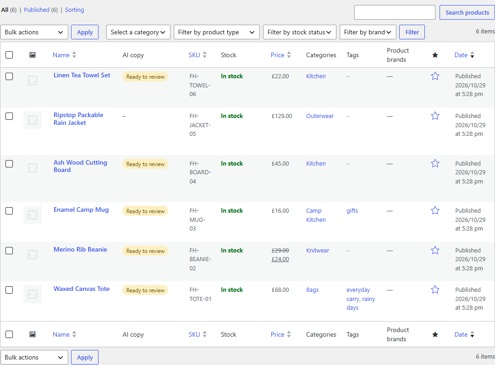

# AI Product Writer for WooCommerce

A WordPress plugin that writes WooCommerce product descriptions, short descriptions and SEO meta (title, description, focus keyword) with the OpenAI API, or with any OpenAI-compatible endpoint.

Stores with hundreds of products usually have thin or copied descriptions and no meta descriptions, because writing them by hand takes too long. This plugin takes the facts the store already has (name, categories, attributes, price, size, weight) plus a short note from the owner and turns them into product copy. A shop manager **reviews and edits every field before anything is saved**, then clicks Apply, and Undo puts back what was there before. The plugin checks each answer before showing it: HTML is reduced to a safe subset, overlong meta fields are cut at word boundaries, and **numbers that aren't in the product data are flagged**, because invented capacities or warranty years are the most common way AI product copy goes wrong. Whole catalogs can be done with a bulk action that runs in the background through Action Scheduler.



*Captured from a real run in WordPress Playground with the plugin's mock OpenAI server (see [Limitations](#limitations)).*

## How it works



### What gets generated

| Field | Where it goes | Checks |
| --- | --- | --- |
| Description | `post_content` | `wp_kses` to `p ul ol li strong em h3 br`, no attributes. Plain text is wrapped in paragraphs. Warns when it's under half or over twice the target length |
| Short description | `post_excerpt` | Plain text, max 300 characters (cut at a sentence). Taken from the description's first paragraph if the model leaves it out |
| Meta title | Yoast, Rank Math or built-in | Max 60 characters, cut at a word boundary |
| Meta description | Yoast, Rank Math or built-in | 120–155 characters. Longer ones are shortened with "…", shorter ones get a warning |
| Focus keyword | Yoast, Rank Math or built-in | Lowercased. Warns if it isn't in the title or meta description (word order doesn't matter) |

Across all fields, numbers in the copy are compared with the numbers in the product facts. `1,200` matches `1200` and `2.5` matches `2.50`, and single digits are ignored. Placeholder text ("lorem ipsum", "as an AI") gets a warning too.

### The prompt

[src/Content/PromptBuilder.php](src/Content/PromptBuilder.php) sends a system message with the rules (language, tone, length, the JSON keys, "use only the facts provided", no health or superlative claims) and a user message with the product facts as JSON. Facts come from [src/Content/ProductFacts.php](src/Content/ProductFacts.php): visible attributes only (a hidden "Supplier code" never leaves the site), category names without "Uncategorized", a sale price with the regular price, a variable product's price range, and the current description as plain text so a rewrite keeps its facts. The settings page adds tone, brand voice, language (defaults to the site's) and store rules.

If the answer isn't usable JSON or is missing fields, the generator sends the answer back once with the error ("The model's answer is missing: meta_title") and asks again. Small local models need this more often than GPT-4.1.

### Talking to the API

[src/Ai/OpenAiClient.php](src/Ai/OpenAiClient.php) uses `wp_remote_post` and the Chat Completions endpoint only, so it works with OpenAI, Azure OpenAI's v1 endpoint, OpenRouter, Ollama and LM Studio.

- **Retries** on timeouts, connection errors, 408/409/429/5xx and empty answers, up to 3 attempts. It honours `retry-after-ms` and `Retry-After` (capped at 20 s), otherwise backs off 1 s, 2 s, … plus jitter.
- **No retry** when retrying can't help: a bad key (401), `insufficient_quota`, a 400, a refusal, or an answer cut off at the token limit.
- **Readable errors.** "The API key was rejected (401). Check it under WooCommerce → AI Product Writer.", "The OpenAI account is out of credit", "Could not reach api.openai.com: cURL error 28…". These show in the meta box and on the product list.
- **Key handling.** `WAPW_OPENAI_API_KEY` in wp-config.php, then the `OPENAI_API_KEY` environment variable, then the settings page. The settings field never shows the saved key, only its last 4 characters. No key is needed for a local endpoint.

### Bulk generation

"Write copy with AI" on Products → All Products queues one Action Scheduler job per product ([src/Jobs/Queue.php](src/Jobs/Queue.php)). Products that already have a description are skipped by default. A product that's already queued isn't queued twice. Rate limits and outages are retried after 1 and then 2 minutes, then the product is marked failed with the error, which also goes to the WooCommerce log. Depending on the setting, finished copy either waits for review in the product's meta box or is applied straight away, with undo available either way. The "AI copy" column shows Queued, Ready to review, Applied or Failed (hover for the error).



### SEO plugins

[src/Seo/SeoAdapter.php](src/Seo/SeoAdapter.php) maps the three SEO fields to Yoast's (`_yoast_wpseo_title`, `_metadesc`, `_focuskw`) or Rank Math's (`rank_math_title`, `_description`, `_focus_keyword`) post meta, picked automatically. With neither installed, the plugin stores them itself and [src/Seo/NativeSeo.php](src/Seo/NativeSeo.php) prints `<meta name="description">` and swaps the title part of `<title>` on product pages. The SEO meta is written before `$product->save()`, because Yoast rebuilds its indexable on `save_post`. Undo writes back to the plugin the backup came from, even if the store switched SEO plugins in between.

### Guard rails

- REST routes check `edit_product` for that product. The connection test needs `manage_woocommerce`. Bulk actions skip products the user can't edit.
- 30 generations per user per hour from the product screen (configurable, `wapw_rate_limit` filter).
- Copy edited in the browser is sanitized again on apply.
- Monthly request and token counts on the settings page.
- Uninstall removes settings, usage, queued jobs and the plugin's bookkeeping meta. Applied descriptions stay, since they're the store's content now.

### Extending it

| Hook | Use |
| --- | --- |
| `wapw_product_facts` | Add custom fields (ACF, materials, care instructions) to what the model sees |
| `wapw_prompt_messages` | Change the prompt |
| `wapw_request_body` | Add `max_completion_tokens`, `seed`, … |
| `wapw_generated_copy` | Post-process the result |
| `wapw_allowed_description_html` | Allow more tags |
| `wapw_copy_applied` (action) | React to an apply (purge caches, log) |
| `wapw_max_attempts`, `wapw_rate_limit` | Tune retries and the per-user limit |

## Tech stack

- PHP 8.1+ WordPress plugin (no Composer dependencies at runtime): WooCommerce CRUD, REST API, Settings API, Action Scheduler, WP-CLI command
- OpenAI Chat Completions over the WordPress HTTP API, JSON mode
- Vanilla JS meta box on `wp.apiFetch` (no build step)
- PHPUnit 11 integration tests against real WordPress 7.1.4 + WooCommerce 11.2.1 on SQLite, run on [PHP-WASM](https://github.com/WordPress/wordpress-playground) so no local PHP or MySQL is needed
- [WordPress Playground CLI](https://wordpress.github.io/wordpress-playground/developers/local-development/wp-playground-cli) for the demo, plus a zero-dependency Node mock of the OpenAI API
- Docker Compose (WordPress 7.1.4, MariaDB 11.4, WP-CLI) as an alternative

## Run it

### Option 1: WordPress Playground (Node only)

```bash
npm install
npm run demo
```

This opens WordPress + WooCommerce at http://127.0.0.1:9400 (already logged in) with the plugin mounted from this folder and six demo products from a made-up store, Fernhill Supply Co. Five of them have no description yet. By default the plugin talks to the bundled mock API, which builds tidy but formulaic copy from the product data, so no key is needed. For real output:

```bash
OPENAI_API_KEY=sk-... npm run demo                 # OpenAI, gpt-4.1-mini (OPENAI_MODEL to change)
npm run demo -- --ollama                           # local Ollama, llama3.2:3b-instruct-q8_0 (OLLAMA_MODEL); not tried here, see Limitations
```

The site lives in memory and resets on every start. `npm run demo` reuses WooCommerce from `.wp-test/` if `npm run setup:wp` has run; otherwise Playground downloads it.

### Option 2: Docker

```bash
cp .env.example .env          # add OPENAI_API_KEY and OPENAI_BASE_URL=https://api.openai.com/v1 for real output
docker compose up
```

The `setup` service installs WordPress and WooCommerce, activates the plugin and seeds the demo products. Then open http://localhost:8080/wp-admin/edit.php?post_type=product (admin / password). The plugin folder is mounted read-only, so code changes show up on reload.

### Option 3: An existing store

`npm run zip` builds `dist/woo-ai-product-writer-1.0.0.zip` (plugin files only, 28 files, ~45 KB). Upload it under Plugins → Add New → Upload, then go to **WooCommerce → AI Product Writer**, add a key and click **Test connection**.

### Try it

1. Open **Waxed Canvas Tote**. The notes field is already filled in. Click **Generate copy**, edit something, untick the focus keyword and click **Apply selected to product**. Then click **Undo last AI apply**.
2. View the product page source: `<title>` and `<meta name="description">` come from the generated meta.
3. On the product list, select everything and choose **Write copy with AI**. The rain jacket is skipped because it has a description, and the others show "Ready to review" once Action Scheduler has run.
4. Break things: `MOCK_FAILURE_RATE=0.5 MOCK_LATENCY_MS=1500 npm run demo` (or the same in `.env` for Docker) makes the mock slow and return 503s half the time. Generations retry, and bulk jobs that still fail are rescheduled, then marked "Failed" (reason on hover) after three tries.

### WP-CLI

```bash
wp ai-writer generate 42 57              # suggestions to review
wp ai-writer generate 42 --apply --notes="Mention the brass rivets"
wp ai-writer generate --all --only-empty --limit=50 --queue
wp ai-writer apply 42
wp ai-writer undo 42
```

In Docker: `docker compose run --rm --entrypoint wp setup ai-writer generate --all --queue`.

## Tests

```bash
npm test                      # first run downloads WordPress, WooCommerce, the SQLite drop-in and PHPUnit (~60 MB)
npm test -- --filter Applier  # extra arguments go to PHPUnit
```

`npm run setup:wp` builds a real WordPress 7.1.4 + WooCommerce 11.2.1 site in `.wp-test/` on SQLite. [scripts/php.mjs](scripts/php.mjs) runs PHP 8.3 as WebAssembly with the repo mounted, and PHPUnit loads that site with the plugin active. Each test runs in a database transaction that is rolled back, and HTTP calls are answered by a fake (`pre_http_request`), so no API key or network is needed. With PHP installed, `composer install && vendor/bin/phpunit` runs the same suite after `npm run setup:wp`.

107 tests, about 17 s:

- **Copy parsing and checks** (19): code fences and chatter around JSON, alternate key names, missing fields, broken JSON, `<script>`/`onclick`/links stripped, meta title and description shortening, derived short description, keyword checks, invented numbers flagged (`25-year guarantee`, `100%`) and number formats matched loosely, re-sanitizing browser edits.
- **OpenAI client** (18): request shape, no key / local endpoint, environment overrides, `Retry-After` and `retry-after-ms`, capped waits, backoff then give up, transport errors, quota and 401 not retried, refusals, cut-off and empty answers, a 200 that isn't Chat Completions.
- **Prompt and product facts** (8): real simple and variable products, sale prices, taxonomy attributes, hidden attributes and "Uncategorized" left out, existing copy capped, settings in the prompt, site language fallback.
- **Generator** (6): suggestion stored without touching the product, notes reused, monthly usage, one repair round, giving up after it.
- **Apply / undo** (10): native, Yoast and Rank Math keys, SEO off, subsets of fields, undo restoring and deleting what was empty, undo after switching SEO plugin, quotes and backslashes.
- **REST API** (15): auth (logged out, customer, shop manager), 404 for non-products, generate → edit → apply → undo, 409s, 502 on API errors and bad output, 400 for no key, unknown fields rejected, discard, per-user rate limit, connection test.
- **Queue and bulk action** (13): Action Scheduler jobs, no double queueing, review and apply modes, 429 retried later with backoff, failing for good, permission and "only empty" filtering, the status column.
- **Settings, admin screens and SEO output** (11): key kept/cleared, values clamped, sanitizer on every save path, key source, settings page and meta box rendering (the saved key never appears in the HTML), `<meta name="description">` and `<title>` on product pages only.
- **WP-CLI command** (7): against a small WP-CLI API stub ([tests/Support/WpCliStub.php](tests/Support/WpCliStub.php)).

The UI was also checked by hand in Playground with Playwright: generate, edit, apply (description, excerpt and front-end `<title>` change), undo, and the bulk action through Action Scheduler. [scripts/screenshot.py](scripts/screenshot.py) repeats that flow and captures the screenshots.

## Configuration

**WooCommerce → AI Product Writer**

| Setting | Default | |
| --- | --- | --- |
| API key | – | Or `WAPW_OPENAI_API_KEY` (wp-config.php) / `OPENAI_API_KEY` (env), which win |
| Base URL | `https://api.openai.com/v1` | Or `WAPW_OPENAI_BASE_URL` / `OPENAI_BASE_URL` |
| Model | `gpt-4.1-mini` | Or `WAPW_OPENAI_MODEL` / `OPENAI_MODEL` |
| Temperature | `0.7` | Empty = not sent (for models that reject it) |
| JSON mode | on | Turn off for servers that don't support `response_format` |
| Timeout | 45 s | Per attempt |
| Tone, brand voice, store rules | Friendly | Go into the system prompt |
| Language | site language | |
| Description length | 180 words | |
| Write SEO fields to | auto | Yoast, Rank Math, built-in, or nowhere |
| After bulk generation | keep for review | Or apply straight away |
| Skip products with a description | on | Bulk and `--only-empty` |
| Per-user limit | 30 / hour | 0 = none |

## Project layout

```
woo-ai-product-writer.php   plugin header, autoloader, HPOS declaration
src/Plugin.php              wiring
src/Settings.php            options, key/base URL/model precedence, sanitizing
src/Ai/                     Chat Completions client, errors
src/Content/                ProductFacts → PromptBuilder → Generator → GeneratedCopy (checks) → Applier (backup/undo)
src/Seo/                    Yoast / Rank Math / built-in meta keys, built-in <meta> output
src/Rest/RestController.php /wapw/v1 routes
src/Jobs/Queue.php          Action Scheduler jobs with retry
src/Admin/                  meta box, bulk action + column, settings page
src/Cli/Command.php         wp ai-writer
assets/                     admin.js (meta box UI), settings.js, admin.css
mock-openai/server.mjs      OpenAI-compatible mock for demos
demo/                       demo products + seeder
playground/                 Playground blueprints
scripts/                    php.mjs (PHP-WASM runner), test/setup/demo/zip, screenshot.py
tests/                      PHPUnit integration tests, test-site installer
docker-compose.yml, docker/ Docker alternative
```

## Limitations

- **Not run against the real OpenAI API.** This machine has no API key. The client follows the documented Chat Completions format and is tested against recorded-shape responses, and the full UI flow ran against the mock server in Playground. The screenshot shows mock output: the mock fills a template from the product data, so its copy is formulaic and shorter than the 180-word target, which is why the length warning shows. A run with the local Ollama model was planned for the screenshot, but the Ollama server here stopped answering chat requests.
- **Docker setup untested.** No Docker on this machine. The image tags exist, but `docker compose up` hasn't been run.
- **Yoast and Rank Math are tested at the post-meta level**, not with the plugins installed. Their meta keys are stable and documented, and saving the product triggers Yoast's indexable rebuild, but the result hasn't been checked in either plugin's UI.
- **Single-level undo.** Undo restores what the *last* apply overwrote. Applying twice and undoing once leaves the first AI version.
- **Backslashes in descriptions are lost** by WooCommerce's own CRUD layer (it saves through `wp_update_post` without slashing). This happens with any plugin, and SEO meta keeps them.
- **The number check is a heuristic.** It catches invented figures, but not invented words ("waterproof" when the product is only water-resistant). The review step is the real safeguard.
- **Product data goes to the API provider.** Only catalog data and the merchant's notes are sent, no customer data. Stores that can't send even that can point the base URL at a local model.
- **The API key is stored in plain text in `wp_options`** when entered on the settings page, like most WordPress plugins. The wp-config constant or environment variable avoids that.
- **The usage counter isn't atomic.** Parallel background jobs can undercount slightly. It's an estimate, not billing.
- **PHP-WASM's packages declare Node ≥ 24.** Everything here ran on Node 22.21 (npm prints an engine warning), and CI uses Node 24.

Fernhill Supply Co. and its products are made up.

## sort entries

Updated implementation details.

## load config

Updated implementation details.